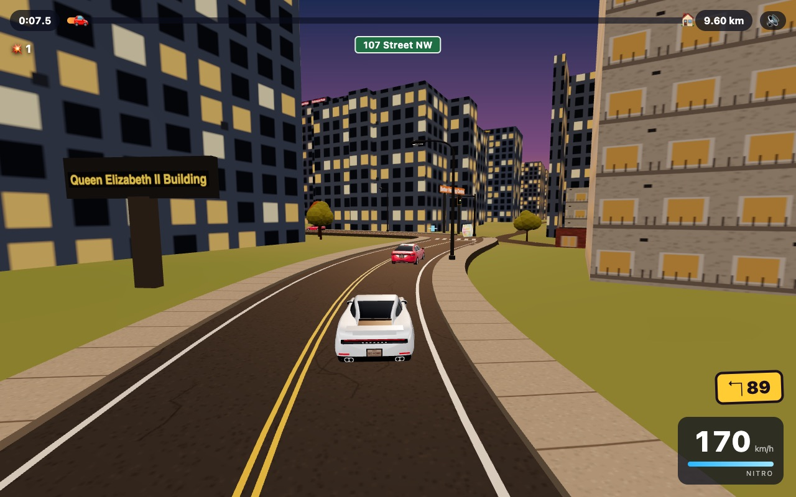

# Drive Home

A 3D driving game in the browser, on real Edmonton roads: beat the rush-hour commute.

**Play: https://drive-home-beta.vercel.app**



The streets, buildings, hills, river valley and traffic lights all come from real open data, so the drive follows the real city: Gateway Boulevard, the Walterdale and High Level bridges, the Anthony Henday, Saskatchewan Drive. Dodge traffic, grab nitro, time the lights and get there before the clock runs out. It runs in any modern browser, on a laptop or a phone.

## What's in it

- **8 routes** from two starting points, plus **your own routes**: type any two places inside Edmonton and the game builds that drive in about 5–15 seconds.
- **A garage**: the team's six cars (Tesla Model X, Honda CR-V, Honda Accord, Lexus IS 300, Subaru Legacy, Kia Carnival), each modelled from the maker's official photos; a bicycle and Cam's E-bike; four **supercars** (Lamborghini Revuelto, Ferrari 296 GTB, Porsche 911 Turbo S, McLaren 750S); and fun rides (Poutine, Oilers Jersey, Rogers Place, and the Rocket, unlocked by finishing every achievement).
- **Power-ups**: nitro cans, and **?** boxes with a shield, turbo, flying, or a blast that clears the road.
- **Real landmarks**: the Legislature, the downtown skyline, Rogers Place, West Edmonton Mall, the Muttart pyramids, the High Level Bridge, the refineries and more. Gas stations, restaurants, banks and big-box stores show their real brands.
- **Real engine sounds**: recordings of real engines for every car (Freesound, public domain).
- **An online leaderboard** (best time per player per map) and **achievements**.
- A themed ending scene for each destination.

## Controls

| Key | Action |
|---|---|
| ↑ / ↓ | Gas / brake |
| ← / → | Steer |
| Shift | Nitro |
| H | Horn |
| M | Sound on/off |

On a phone or tablet, on-screen buttons appear.

## Routes

| Route | Starts at | Length |
|---|---|---|
| Odd Burger | Summerside | 1.5 km |
| Summerside Beach Club | Summerside | 1.6 km |
| Noodle Feast | Summerside | 7.1 km |
| Windermere | Summerside | 11.3 km |
| Downtown (to the Legislature) | Summerside | 15.6 km |
| Sherwood Park | Summerside | 22.2 km |
| Snow Valley | Downtown | 9.8 km |
| Refinery Row (to Sherwood Park Mall) | Downtown | 15.8 km |

The Summerside routes start at a public spot on 91 St SW; the Downtown routes start on 107 St by the Legislature.

## Running it on your computer

You need [Node.js](https://nodejs.org) 22.12+ for the game and backend tools.

```
npm ci
npm run dev        # then open http://localhost:5173
```

The game works without any environment configuration. Without `VITE_LEADERBOARD_API`, the leaderboard is hidden and progress is saved on the device. To use a local leaderboard:

```sh
cp .env.example .env.local
npm run online:init:local
npm run online:dev   # leave running; starts the API on port 8787
# In another terminal:
npm run dev
```

The example points to the local API, whose database is separate from production. For a deployed backend, set `VITE_LEADERBOARD_API` to your Worker URL and allow the game's exact origin in the Worker configuration. Restart Vite after changing `.env.local`.

The backend uses a small Cloudflare D1 database. There is no database password or Supabase SDK in the game. See [the backend setup and migration guide](worker/README.md) for deployment and existing-player migration.

Other commands:

```
npm run build        # checks every map's road lines, then builds into dist/
npm run check:roads  # just the road-line check
npm run test:online  # backend identity, scores, progress and abuse checks
npm run preview      # serve the built game
```

Developer pages, on the dev server: `/car-studio.html?id=crv` (one car from six angles), `/landmark-studio.html?id=legislature` (one landmark), `/sound-studio.html` (every sound, an engine panel and a scripted test drive).

## How it's made

Plain JavaScript and [Three.js](https://threejs.org), built with [Vite](https://vite.dev). No framework. Hosting and the leaderboard use free plans; the map and address services need no API keys. Cloudflare deployment requires account sign-in, and temporary migration credentials stay on the server.

The maps are built ahead of time by `node tools/build-maps.mjs` into `public/maps/`, from free open data:

- **Routes**: the OSRM routing server
- **Roads, lane counts, traffic signals, railways, shop and brand names**: OpenStreetMap, cut into tiles in `public/osm/` that the game also uses for custom routes
- **Building outlines and heights**: City of Edmonton rooflines; building types from City zoning
- **Hills and the river valley**: Natural Resources Canada elevation data

Custom routes run the same map builder (`src/mapgen/`) inside the browser, so they look as good as the built-in ones. Address search uses Photon and Nominatim, limited to Edmonton.

| Folder | What's there |
|---|---|
| `src/` | The game: `main.js` (menu, race, driving), `world.js` (building the 3D city), `cars.js` and `supercars/`, `traffic.js`, `signals.js`, `sound.js`, `landmarks/`, `mapgen/` (the map builder) |
| `public/` | Built maps, OpenStreetMap tiles, sounds |
| `tools/` | Map and sound builders, the road-line check, test scripts in `tools/dev/` |
| `worker/` | Cloudflare leaderboard API, D1 schema and backend tests |
| `supabase/schema.sql` | Historical Supabase schema, retained for migration and rollback |

[`CLAUDE.md`](CLAUDE.md) has the full project notes: how every part works, the rules that keep road lines and bridges right, how to add a map, car, landmark, brand or sound, testing and performance targets, and the to-do list.

## Deploying

The game is served as static files on Vercel Hobby. The leaderboard API runs on Cloudflare Workers and D1. Existing anonymous Supabase players can transfer their identity before **November 21, 2026 at 00:00 UTC**; new and transferred players use D1 only. The old Supabase authentication service is needed only for these temporary identity claims. See [the backend guide](worker/README.md) for deployment, migration cleanup and recovery.

Pushing to `main` on GitHub deploys the live game automatically, so work in progress goes on a branch and goes to `main` only once it has been checked and the owner has approved deployment. Worker changes require a separate Wrangler deployment.

### Costs and traffic protection

Verified October 21, 2026: **Vercel Hobby ($0, no trial)** and **Cloudflare Workers Free ($0)**. Keep both plans free. Exhausting their free quotas can temporarily interrupt service instead of charging usage overages. Paid upgrades and add-ons require the owner's approval. See [Vercel Hobby](https://vercel.com/docs/plans/hobby), [Workers pricing](https://developers.cloudflare.com/workers/platform/pricing/) and [D1 pricing](https://developers.cloudflare.com/d1/platform/pricing/).

The API rejects excess traffic before database access: 300 reads and 120 writes per IP per minute, with a separate limit of 20 new accounts per IP per hour. The minute counters are approximate per Cloudflare location; the free account plans provide billing protection. Only each player's best score per built-in map is stored, and score submissions are limited to one every ten seconds. Full limits and operating notes are in [the backend guide](worker/README.md#operations).

## Credits

- Map data © [OpenStreetMap](https://www.openstreetmap.org/copyright) contributors (ODbL)
- Contains information licensed under the Open Government Licence – City of Edmonton
- Elevation: Natural Resources Canada (Open Government Licence – Canada)
- Routes: [OSRM](https://project-osrm.org); address search: [Photon](https://photon.komoot.io) and [Nominatim](https://nominatim.org)
- Engine, turbo and tyre sounds: recordings by Chippy569, dezoris, ulose2piranha, editboy23, PritzProductions, victormalloy, cheesepuff, audible-edge, TiesWijnen, justVova, megashroom and reg7783 on [Freesound.org](https://freesound.org) (CC0); the full list with links is in `CLAUDE.md`
- Car and brand names belong to their owners; this is a fan-made game with no connection to them.
